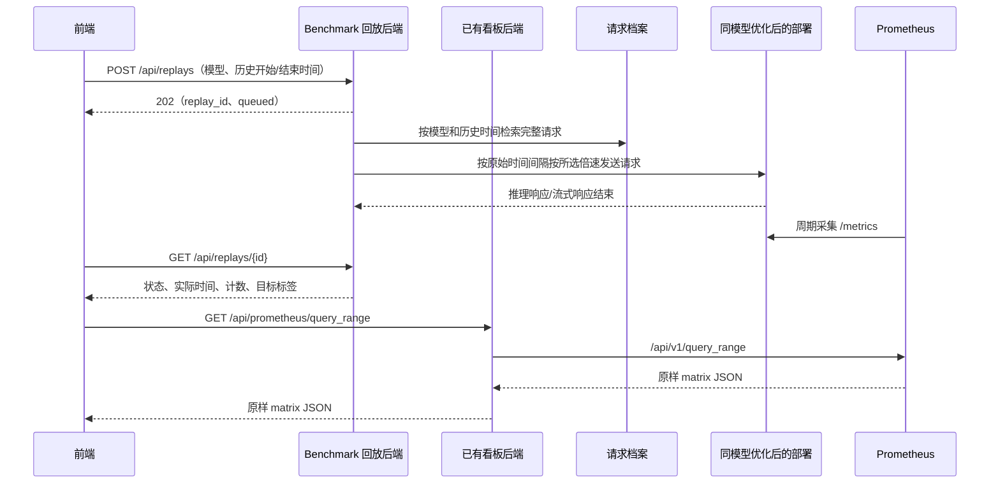

# TrafficReplay 流量回放接口对接文档

本文依据当前前端 `src/App.tsx`、`src/replay.ts`、`src/data.ts` 和 `src/types.ts` 编写。回放接口已适配独立 Benchmark 后端，指标接口使用已有看板后端；真实部署地址与认证仍需联调，文档不表示已连接真实服务。

2026-10-15 已复核 Benchmark `ef22cd2`：数字倍速与 `speed: "burst"` 的创建、返回和恢复契约兼容。下文的轻量状态、版本号、指标映射和取消原子性仍有后端实现缺口，burst 也未在全部发送后及时进入 draining；实测影响见 [README 对接检查](../README.md#当前-benchmark-对接检查与缺口)。

## 1. 功能与接口范围

用户选择一个模型，在历史处理/等待曲线中拖选区间，再确认回放。前端提交模型、历史开始时间、历史结束时间及倍速。数字倍速按原始请求间隔除以倍速调度；`speed: "burst"` 忽略历史间隔，尽快提交所选区间的全部请求。

创建任务采用异步方式：接口返回任务 ID，后台继续检索、调度和发送请求。前端通过状态接口获取实际打流时间，再使用已有 Prometheus 接口查询回放后的曲线。

| 接口 | 方法 | 用途 | 对接范围 |
| --- | --- | --- | --- |
| `/api/replays` | POST | 创建回放任务，返回任务 ID | Benchmark 提供 |
| `/api/replays/active?view=status` | GET | 恢复当前活动任务 | Benchmark 提供 |
| `/api/replays/{id}/cancel` | POST | 请求取消任务 | Benchmark 提供 |
| `/api/replays/{id}` | GET | 查询状态、计数、实际开始/结束时间、目标指标标签 | Benchmark 提供 |
| `/api/prometheus/query_range` | GET | 查询历史及回放后的处理/等待曲线、首 Token 延迟趋势 | 使用已有接口 |
| `/api/prometheus/query` | GET | 模型发现、原有五项延迟及新增五项回放实时延迟 | 使用已有接口 |

前端已支持倍速、活动任务恢复、进度、取消及刷新后的曲线重建，没有完整任务列表。手动认证刷新后重新输入密钥即可恢复，服务端代理认证模式可自动恢复。



## 2. 公共约定

### 2.1 地址与时间

- 看板后端：`http://<DASHBOARD_BACKEND_IP>:<DASHBOARD_BACKEND_PORT>`。
- LiteLLM：`http://<LITELLM_IP>:<LITELLM_PORT>`；vLLM：`http://<VLLM_IP>:<VLLM_PORT>`。这些打流地址和服务凭据由后端维护。
- Prometheus：`http://<PROMETHEUS_IP>:<PROMETHEUS_PORT>`，由已有看板后端代理。
- 浏览器请求同源 `/api/...`；本地由 Vite 代理，生产由静态服务反向代理。
- 所有接口时间字段为 JSON number，单位为 Unix **秒**。本次契约使用整数秒，不传 JavaScript 毫秒，也不传日期文本。
- 回放档案过滤区间为 `[start_time, end_time)`：包含开始，不包含结束。后端可保留档案原始时间的毫秒精度来调度请求，不必将请求时间取整。
- 页面按 `Asia/Shanghai` 展示和解释输入；时间戳本身无时区歧义。

示例时间：`1791770400` 对应上海时间 `2026-10-12 10:00:00`；`1791771000` 对应 `2026-10-12 10:10:00`。

### 2.2 请求头与认证

创建接口发送：

```http
Content-Type: application/json
Idempotency-Key: <UUID>
```

若在页面“连接设置”输入了认证值，POST 和状态 GET 会携带所选的一种认证头：

```http
Authorization: Bearer <TOKEN>
```

或 `x-api-key: <KEY>`，或 `x-litellm-key: <KEY>`。页面只发送选中的一种；没有填写认证值则不发送。后端按自己的认证规则校验，并建立到 LiteLLM/vLLM 的调用权限。

连接设置默认选择 `Authorization`。独立 Benchmark 仅接受 `Authorization: Bearer <BENCHMARK_API_KEY>`；认证值需手动填写 `Bearer ` 加服务端密钥实际值，不带尖括号，前端不会自动补前缀。LiteLLM Master Key 由 Benchmark 后端维护。

Prometheus 查询不携带这些认证头。`Idempotency-Key` 只随创建 POST 发送。

回放成功响应为直接 JSON 对象，不能包装成 `{ "data": { ... } }`。任务状态接口建议返回 `Cache-Control: no-store`，不要套用 Prometheus 的 30 秒查询缓存。前端单次 HTTP 请求超时为 **20 秒**。

## 3. 创建回放任务

来源沿用 Prometheus 模型下拉框（配置唯一别名时提交档案别名）；目标通过“选择打流目标”按钮从 Benchmark `GET /api/models` 返回的 `target_models: string[]` 中选择。该列表路由与回放接口使用同一 Benchmark 地址；当前列表接口不要求 Benchmark 认证。无有效目标时前端禁止创建。

### 3.1 请求

```http
POST /api/replays
```

```json
{
  "source_model": "DeepSeek-R1",
  "target_model": "DeepSeek-R1-optimized",
  "start_time": 1791770400,
  "end_time": 1791771000,
  "speed": 1
}
```

| 字段 | 类型 | 必填 | 含义 |
| --- | --- | --- | --- |
| `source_model` | string | 是 | 历史来源；当前下拉框的模型名，配置唯一映射时为档案别名 |
| `target_model` | string | 是 | Benchmark `target_models` 中选择的 LiteLLM 打流目标 |
| `start_time` | number | 是 | 历史区间开始，Unix 整数秒 |
| `end_time` | number | 是 | 历史区间结束，Unix 整数秒，必须大于开始 |
| `speed` | number \| `"burst"` | 前端始终发送 | 有限正数，或精确字符串 `"burst"`；控件显示 0.5、1、2、5、10、`∞`，默认 1 |

当前前端发送这五个字段，不发送目标 IP、部署实例或完整请求内容。来源与目标可以相同，也可以不同。界面 `∞` 只是 `"burst"` 的显示形式，不增加布尔字段；其他选项继续发送 JSON number。数字倍速只缩放发送间隔，不修改推理耗时，1× 表示原速；`"burst"` 不再等待历史间隔，在空闲并发槽位出现时继续发送后续请求，提交速度和实际并发仍受后端线程池、队列与上游容量限制。后端按来源检索历史记录，并保存固定的目标和来源上下文。

突发模式请求示例：

```json
{
  "source_model": "DeepSeek-R1",
  "target_model": "DeepSeek-R1-optimized",
  "start_time": 1791770400,
  "end_time": 1791771000,
  "speed": "burst"
}
```

### 3.2 响应

推荐返回 `202 Accepted`，表示任务已受理，执行尚未完成。当前前端也能解析其他正常的 2xx JSON 响应。

```json
{
  "replay_id": "replay-20261012-0001",
  "model_id": "DeepSeek-R1-optimized",
  "source_model": "DeepSeek-R1",
  "target_model": "DeepSeek-R1-optimized",
  "start_time": 1791770400,
  "end_time": 1791771000,
  "speed": 1,
  "status": "queued",
  "cancellable": true,
  "revision": 1,
  "target": {
    "metrics_labels": {
      "model_name": "DeepSeek-R1",
      "deployment": "deepseek-optimized"
    }
  }
}
```

| 字段 | 类型 | 对接要求 | 含义 |
| --- | --- | --- | --- |
| `speed` | number \| `"burst"` | 原样返回创建时固定值 | 有限正数或 `"burst"`，恢复时不依赖控件当前值 |
| `cancellable` | boolean | 返回是否可取消 | cancelling 和终态为 false |
| `revision` | number | 推荐返回递增版本 | 拒绝迟到的旧快照 |
| `replay_id` | string | 必须返回非空任务 ID | 后续状态 GET 的路径参数；不能改名为 `id` 或 `task_id` |
| `status` | string | 应返回 | 使用第 5 节中的固定英文状态；通常是 `queued` 或 `preparing` |
| `started_at` | number | 实际发送开始后才返回 | 第一个回放请求实际发出的时间，Unix 秒 |
| `request_count` | number | 数量确定后返回 | 本任务实际纳入回放的总请求数；尚未确定时省略 |
| `target.metrics_labels` | object | 可选，推荐返回 | Prometheus 中定位优化后目标部署的标签，值均为字符串 |

任务没有开始时省略 `started_at`，不要填写按钮点击时间或预计开始时间。不要为未知总请求数填写 `0`；`0` 表示确实没有请求。

### 3.3 幂等语义

前端在相同模型、时间与倍速条件的创建失败后重试时复用 `Idempotency-Key`。创建成功后再次进行回放会生成新键。

后端需要实现以下行为，不能仅接收请求头后忽略它：

| 情况 | 后端行为 |
| --- | --- |
| 相同键、相同有效参数 | 返回原任务 ID；不能再创建任务或再打一次流 |
| 相同键、不同有效参数 | 返回 `409 Conflict` |
| 不同键、相同请求体 | 可以作为新的实验创建任务，受后端并发策略约束 |

幂等记录、任务创建和调度入队要避免并发重复；可采用数据库唯一约束和事务/可靠队列。幂等记录应覆盖客户端重试期及任务运行期，不能沿用 30 秒指标缓存 TTL。

如果 POST 在浏览器 20 秒超时前没有返回，但后端已经创建了任务，下一次同键请求必须仍返回这个任务。创建接口应尽快返回，不应等待数分钟/数小时的回放全部结束。

## 4. 查询任务状态

### 4.1 请求

```http
GET /api/replays/replay-20261012-0001
```

`{id}` 为创建响应的 `replay_id`；前端插入路径前会进行 URL 编码。没有请求体，不需要传历史时间或再次传模型。

### 4.2 运行中响应

```json
{
  "replay_id": "replay-20261012-0001",
  "model_id": "DeepSeek-R1-optimized",
  "source_model": "DeepSeek-R1",
  "target_model": "DeepSeek-R1-optimized",
  "start_time": 1791770400,
  "end_time": 1791771000,
  "speed": 1,
  "status": "running",
  "cancellable": true,
  "revision": 24,
  "started_at": 1791774000,
  "request_count": 1200,
  "sent_count": 600,
  "completed_count": 560,
  "target": {
    "metrics_labels": {
      "model_name": "DeepSeek-R1",
      "deployment": "deepseek-optimized"
    }
  }
}
```

### 4.3 完成响应

```json
{
  "replay_id": "replay-20261012-0001",
  "model_id": "DeepSeek-R1-optimized",
  "source_model": "DeepSeek-R1",
  "target_model": "DeepSeek-R1-optimized",
  "start_time": 1791770400,
  "end_time": 1791771000,
  "speed": 1,
  "status": "succeeded",
  "cancellable": false,
  "revision": 60,
  "started_at": 1791774000,
  "finished_at": 1791774620,
  "request_count": 1200,
  "sent_count": 1200,
  "completed_count": 1200,
  "target": {
    "metrics_labels": {
      "model_name": "DeepSeek-R1",
      "deployment": "deepseek-optimized"
    }
  }
}
```

| 字段 | 类型 | 对接要求 | 含义 |
| --- | --- | --- | --- |
| `status` | string | 每次必填 | 当前状态；未知状态会触发前端错误 |
| `replay_id` | string | 必须返回 | 创建、恢复和状态校验使用同一任务 ID |
| `model_id` / `target_model` | string | 必须返回其一 | 固定目标模型 |
| `source_model` | string | 推荐返回 | 原始请求来源模型，省略时回退目标模型 |
| `start_time` / `end_time` | number | 必须返回 | 恢复原历史区间 |
| `speed` / `cancellable` / `revision` | number / boolean / number | 与创建响应保持一致 | 固定倍速、取消能力及快照版本 |
| `started_at` | number | 开始后每次返回 | 必须保持实际开始时间一致，不能在后续响应中省略 |
| `finished_at` | number | 终态且工作已结束时返回 | 成功时为最后一个请求响应处理完毕的时间；失败/取消时为任务实际停止且在途请求已结束或被终止的时间 |
| `request_count` | number | 确定后每次返回 | 纳入回放的总数 |
| `sent_count` | number | 开始计数后每次返回 | 已发出的唯一原始请求数；内部重试次数不重复累计 |
| `completed_count` | number | 开始计数后每次返回 | 已结束处理的请求数，建议包含已取得最终结果的成功、错误或超时请求 |
| `target.metrics_labels` | object | 与创建响应保持一致 | 定位目标部署；建议每次返回 |

正常计数应满足 `0 <= completed_count <= sent_count <= request_count`，且已确定的计数不倒退。内部重试等额外诊断计数可另加字段，不要改变上述计数的语义。建议全部成功才使用 `succeeded`；部分失败时如何判定任务结果需要后端确定并保持一致。

创建和状态响应使用同一个适配器。优先读取 `progress.total/completed/sent/skipped`，兼容顶层计数字段；`progress.ready=false`、`total=null` 表示还在准备。未知或省略的字段不清空已知数据，后端仍建议每次返回完整的已知快照。时间/计数未知时应省略顶层字段，不使用 `0` 表示未知。

模型名称下方显示完成数量、总数、进度条、百分比、发送数量、失败/跳过数量和最近成功接收时间。比例由 `completed / total` 计算；总数未知或为零时不显示百分比，也不强制以任务结束将进度填为 100%。

前端展示 `failed_count`、`skipped_count` 和任务 `error`。返回 `200` 和 `status: "failed"` 会显示任务失败与具体原因；已完成数量包含失败请求，100% 不代表任务成功。不要用 HTTP `500` 代替可正常读取的任务失败状态。

## 5. 状态和执行规则

| 状态 | 页面文字 | 后端含义 |
| --- | --- | --- |
| `queued` | 等待开始 | 已入队，等待执行 |
| `preparing` | 准备请求 | 检索档案、核对路由、准备调度 |
| `running` | 回放中 | 已开始发流，仍有请求尚未发送 |
| `draining` | 等待处理完成 | 请求发送完毕，等待在途推理/流式响应结束 |
| `cancelling` | 正在取消 | 等待已提交请求结束；前端继续查询，取消按钮禁用 |
| `succeeded` | 已完成 | 任务成功结束 |
| `failed` | 失败 | 任务执行失败，执行工作已终止 |
| `cancelled` | 已取消 | 任务被取消，执行工作已终止 |

Benchmark 典型过程为 `preparing → queued → running → draining → succeeded`；失败和取消可从非终态进入。终态不能再退回运行状态。

后端以档案中的原始请求到达时间计算调度偏移。例如历史区间 `[10:00:00, 10:10:00)` 内两个请求分别在 `10:00:05`、`10:00:08` 到达，应保留 3 秒间隔。建议以首个纳入回放的请求为调度零点：若首个请求实际于 `11:00:00` 发出，第二个应计划于 `11:00:03` 发出，`started_at` 就是 `11:00:00`。

这会省略选区起点到首个请求之间的空闲时间；当前前端没有“保留起始空闲”开关。请求间的内部空闲间隔应保留，发送采用并发调度，不能等待前一个推理完成后再发送下一个请求。若限速/并发上限导致无法维持原始节奏，应记录该偏差供实验解释。

历史流量和当前路由均以同一个逻辑模型匹配。模型改名后，后端需维护历史档案名称与当前服务名称的对应关系。Prometheus 保存的是指标，不含完整推理请求；回放必须依赖已有请求档案中的请求时间、请求体、路由所需信息，以及原请求使用的流式/非流式等配置。调用凭据由后端选取当前有效配置。

对于流式请求，应等到响应流结束或明确失败才计入 `completed_count`。全部请求发出只能进入 `draining`，不能立即标为完成。后端可以自行设置超时规则，当前前端不会按 45 秒或历史区间长度判定生产任务完成。

## 6. 模型名称与目标指标标签

当前下拉框来自 Prometheus：

```promql
count by (model_name) (vllm:num_requests_running)
```

默认 `source_model` 等于发现的 `model_name`。若档案使用逻辑别名，可在 `.env.local` 配置：

```dotenv
VITE_MODEL_METRICS_MAP='{"deepseek-service":"DeepSeek-R1"}'
```

下拉框和历史指标使用 `DeepSeek-R1`；创建请求提交 `source_model: "deepseek-service"`。`target_model` 独立从目标列表选择；灰度目标别名到实际指标名使用 `VITE_REPLAY_MODEL_METRICS_MAP` 单独配置，不混入正式来源映射；目标映射未配置时兼容旧的共享映射。

若优化后的 Prometheus 模型名变为 `DeepSeek-R1-v2`，后端可以返回：

```json
{
  "target": {
    "metrics_labels": {
      "model_name": "DeepSeek-R1-v2",
      "deployment": "deepseek-optimized"
    }
  }
}
```

回放右侧查询优先使用这里的 `model_name`，因此当前前端支持优化部署的指标名称变化。其他标签会追加为等值匹配条件。标签必须真实存在于两项 vLLM 指标中；随意增加 `replay_id`、部署标签或不存在的标签会导致空结果。

不返回标签时，前端使用创建任务时保存的指标模型名，汇总该模型所有匹配序列。若同一模型同时有多个部署，推荐返回能覆盖整套目标部署的标签。DeepSeek PD 部署不应只过滤单一 `role` 或 `engine`，否则只显示一个阶段/分片；应使用可覆盖 proxy/prefill/decode 的共同部署标签。

## 7. 前端如何获取回放曲线

当前前端立即显示创建响应并发起一次状态查询，此后活动任务在上次请求完成后约 **2 秒**再次查询；同一任务不重叠发起状态请求。查询失败保留上次数据和更新时间，按 5/10/20/30 秒退避，429 使用 Retry-After，缺省退避 60 秒。页面隐藏时暂停，恢复前台后立即尝试刷新（仍遵守错误退避）。收到终态后停止状态查询，即使任务没有 `started_at`。

曲线刷新与状态查询分开执行。尚无 `started_at` 时不查询曲线，但已知总数会显示在进度区和图表占位区；总数未知显示正在统计，提前失败/取消显示结束原因。较慢的指标请求不阻塞任务进度更新。

收到实际开始时间后，以它作为固定起点，查询已有 `/api/prometheus/query_range`：

```promql
sum by (model_name) (
  vllm:num_requests_running{
    model_name="DeepSeek-R1",
    deployment="deepseek-optimized"
  }
)
```

```promql
sum by (model_name) (
  vllm:num_requests_waiting{
    model_name="DeepSeek-R1",
    deployment="deepseek-optimized"
  }
)
```

对应请求参数：

```text
start = started_at
end   = 已终态且有 finished_at 时：finished_at + 2 × 灰度采集间隔（默认 15s，即 +30s）
        其他情况：max(started_at + 30, 当前 Unix 秒)
step  = max(5, ceil((end - start) / 60))
```

两项 gauge 按所有匹配的 role/engine 求和，各展示一条曲线。开始后最少先显示 30 秒窗口；查询结束点可能短暂在未来，真实 Prometheus 的未来区间没有真实样本，前端不会把它变成模拟数据。

后端返回原样 Prometheus matrix，不要将任务响应包装成 Prometheus 格式，也不需要新增“回放曲线接口”。相对时间勾选框只把横轴转换为 `timestamp - started_at`，不修改接口时间参数。

如果后端缓存 `query_range`，缓存键必须包含 `query`、`start`、`end`、`step`。仅以 PromQL 为键会混淆同模型的历史窗口和回放窗口。当前前端自身按完整 URL 去重并缓存 30 秒。

收到实际开始/结束时间时立即刷新一次曲线，运行时曲线独立每 30 秒刷新。已终态任务在 `finished_at + 2 × 灰度采集间隔 + 30 秒缓存余量` 之后发起一轮查询，且两条查询均无错误时停止负载轮询；最终查询绕过此前的前端缓存。使用请求发起时间判断，不能因响应途中休眠或变慢而提前停止。这个条件只预留采集与缓存余量，不验证数据完整；空结果也可能满足停止条件。后端不能省略终态的 `finished_at`，否则曲线仍会持续轮询；状态查询已按终态独立停止。

任务在首个请求发送前就失败/取消时，后端应如实省略 `started_at`；前端停止状态查询且不创建曲线查询，不需要伪造开始时间。

其他现有监测继续工作：原有五项延迟卡仍按左侧当前查询模型，通过五条即时 PromQL 获取；其回溯窗口跟随历史范围，不能直接当作本次回放独立的优化前后延迟报告。

底部另增五项“回放实时延迟”，使用当前任务的目标模型和 `target.metrics_labels`，独立每 30 秒查询同一 `/api/prometheus/query`；历史下拉框、范围和截止时间不改变这些查询。默认采集间隔 15 秒、窗口 60 秒，分别由 `VITE_PROMETHEUS_SCRAPE_INTERVAL_SECONDS` / `VITE_REPLAY_LATENCY_WINDOW_SECONDS` 配置，窗口至少为采集间隔 4 倍。实际开始后先等待两次采集间隔；查询窗口左端不早于 `started_at`，初期不足配置长度时使用已过去的时间。

各个 rate 的范围选择器携带 `@ 观测Unix秒`，包括 TPOT 的全部三个操作数；因此指标后端只透传已有 `query` 参数即可，不依赖它是否额外透传 `time`。Prometheus 需支持并启用 `@`，缓存键必须包含完整 query。终态后观测时刻固定为 `finished_at + 2 × 采集间隔`，再等待 30 秒缓存余量且一轮五项查询无错误后停止轮询；成功空结果也可停止，不代表采集数据完整。取消中继续查询，新任务清空旧值，单项失败保留旧值并标记时间和错误，页面刷新恢复任务后重新查询相同时刻。

这些数值是目标部署短窗口平均，沿用原有五项指标定义和 role/engine 聚合规则，不是最近一条请求或全任务平均。Benchmark 无需新增接口，但应确保返回标签真实存在于负载和延迟指标中；只有 `model_name` 时可能合并同名部署。右侧曲线和新增延迟若来自共享部署，都可能包含其他业务流量；严格的本任务统计需专用部署或后端任务级指标。详见 README 的“独立的回放实时延迟”。

## 8. 回放历史趋势

回放实时延迟卡片下方展示一张全宽首 Token 延迟历史趋势图（TTFT，单位 ms），每轮只新增一条 `GET /api/prometheus/query_range`。使用回放任务的实际 `started_at`、`metricsName` 和 `target.metrics_labels`，不新增 Benchmark 接口。默认每 30 秒刷新，页面刷新后从已保存任务的固定时间重新查询。吞吐率曲线暂不展示或查询。

TTFT 查询使用现有 TTFT histogram 的 sum/count 指标，表达式为：

```promql
1000 * (
  rate(vllm:time_to_first_token_seconds_sum{model_name="目标模型"}[1m]) /
  rate(vllm:time_to_first_token_seconds_count{model_name="目标模型"}[1m])
)
```

曲线解析沿用即时卡片规则：普通模型按 role 分组并平均 engine，配置为混合 role 的模型合并为一条曲线。展示窗口平均延迟。NaN engine 不参与平均，全部缺失或非有限值显示为空点；按查询的 start/end/step 补齐中间漏点为空值，使停采区间断线。响应格式、重复时间戳、查询网格外的点和负延迟会触发查询错误，不覆盖原有成功曲线。每条序列约最多 301 点，步长不小于采集间隔；长任务降采样可能漏掉窄峰。

趋势查询严格等待完整 rate 窗口，窗口左端为 `ceil(started_at + 窗口)`，因此不会把回放前的样本带入。默认窗口为 60 秒，并自动保持为采集间隔的至少 4 倍；采集中显示等待状态，终态补采范围仍不足完整窗口时显示“任务观测时段不足完整统计窗口”并停止等待。等待期间相对横轴仍从实际 `started_at` 的 0 秒起算。终态继续使用 `ceil(finished_at + 2 × 采集间隔)` 的固定评估时刻，再保留 30 秒缓存余量、取得一轮成功响应后停止轮询。TTFT 查询直接复用即时延迟卡片的表达式和自定义指标配置，结果乘以 1000 显示毫秒；模型筛选与响应校验优先使用 `target.metrics_labels.model_name`。首次失败明确提示无成功数据，后续失败保留同一任务的上次成功曲线及时间，成功空结果清空旧数据。切换任务或部署后旧响应无法回写新目标。趋势属于目标部署，可能包含其他业务流量；任务级隔离需要专用部署或后端任务级指标。

## 9. 错误响应

沿用已有后端格式；`details` 最多 200 字符：

```json
{
  "error": "Invalid replay time range",
  "details": "end_time must be greater than start_time"
}
```

以下为建议后端采用的状态码；真实服务若已有约定，应在联调时对齐：

| HTTP 状态 | 用途 |
| --- | --- |
| 400 | 缺字段、类型错误、非法时间、结束不晚于开始 |
| 401 / 403 | 未认证或无该模型/任务的访问权限 |
| 404 | 模型或任务不存在；需区别于接口路径不存在 |
| 409 | 幂等键冲突，或触发后端设定的活动任务冲突策略 |
| 422 | 档案已过期、超出回放范围或确实没有可回放请求 |
| 429 | 超出请求/任务限流；前端按服务及 Retry-After 分别退避，缺省 60 秒 |
| 503 | 当前没有可用的目标路由或执行服务 |
| 504 | 接口依赖服务超时；已受理任务后执行超时应通过任务状态返回 |
| 500 | 接口自身无法正常处理 |

业务任务失败仍允许状态接口返回 `200` 和 `status: "failed"`。HTTP 错误表示此次接口访问失败，与任务的执行状态是两件事。前端支持秒数或 HTTP 日期形式的 `Retry-After`，且回放与指标的限流退避相互独立。

## 10. 后端实现步骤

1. 校验四个请求字段、调用权限、可回放范围和幂等键。
2. 解析逻辑模型到历史档案筛选条件、当前优化部署路由及目标指标标签，固定到任务记录。
3. 持久化任务与幂等关系，可靠入队，尽快返回 `202` 和任务 ID。
4. 后台按档案原始请求时间检索 `[start_time, end_time)` 中的请求，确定 `request_count`。
5. 并发调度：数字 speed 将原始请求到达间隔除以 speed；`"burst"` 忽略历史间隔，按后端并发上限尽快发送全部请求。首个请求提交时记录 `started_at`。
6. 发送完毕转为 `draining`，收集响应结束/错误/超时结果并持续更新计数。
7. 工作结束后记录终态和 `finished_at`；GET 始终返回任务的完整已知状态。

Benchmark 当前全服务只允许一个活动任务，没有用户隔离；其他后端实现也必须提供原子的活动任务约束。

## 11. 前端配置与联调

正式/灰度分源（2026-10-27）：Benchmark 请求和响应契约不变，历史仍查正式 `/api/prometheus`。前端可设置 `VITE_REPLAY_PROMETHEUS_API_PREFIX=/api/replay-prometheus`，让全部回放 vLLM 观测经 Vite/本项目 Nginx **直接**查询灰度 Prometheus；代理服务端设置 `REPLAY_PROMETHEUS_URL=http://<GRAY_PROMETHEUS_HOST>:9090`，将 query/query_range 重写至原生 `/api/v1`。无需给 Benchmark 增加任何接口或配置。上述文档中的回放 `/api/prometheus/*` 路径，在双源模式下对应 `/api/replay-prometheus/*`。Token 吞吐默认跟随回放入口，可用 `VITE_REPLAY_THROUGHPUT_PROMETHEUS_API_PREFIX=/api/prometheus` 独立查询正式 LiteLLM 指标。未配置回放前缀时保持原单源兼容；Compose 模板默认启用双源。完整配置与验证见 [README](../README.md#正式历史与灰度回放指标分离2026-10-27)。

`.env.local`：

```dotenv
BACKEND_URL=http://<DASHBOARD_BACKEND_IP>:<DASHBOARD_BACKEND_PORT>
REPLAY_BACKEND_URL=http://<BENCHMARK_IP>:<BENCHMARK_PORT>
VITE_PROMETHEUS_API_PREFIX=/api/prometheus
VITE_REPLAY_CREATE_PATH=/api/replays
VITE_REPLAY_STATUS_PATH=/api/replays/{id}
VITE_REPLAY_ACTIVE_PATH=/api/replays/active
VITE_REPLAY_CANCEL_PATH=/api/replays/{id}/cancel
VITE_MODEL_METRICS_MAP='{}'
VITE_REPLAY_MODEL_METRICS_MAP='{}'
```

`REPLAY_BACKEND_URL` 可留空，此时回放仍走 `BACKEND_URL`。独立配置时，Vite 将创建/状态路径优先转发给 Benchmark（支持自定义回放路径），其余 `/api` 请求仍走已有看板后端。两个地址只配置代理，不进入浏览器产物。修改配置后重新运行 `npm run dev`。静态生产部署需在 Web 服务中配置相同的路径分流。使用同源代理无需浏览器跨域；若另行采用跨域部署，后端需允许前端 Origin、GET/POST/OPTIONS，以及 `Content-Type`、`Idempotency-Key` 和所用认证头。

联调顺序：

1. 在页面切换“后端”，确认模型、历史曲线正常。
2. 选取有请求档案的历史区间并选择打流目标，确认创建 POST 包含 source_model/target_model/start_time/end_time/speed 五字段；数字选项为 JSON number，`∞` 为字符串 `"burst"`。响应为直接 JSON 且包含 `replay_id`。
3. 验证状态从排队/准备进入运行，首个真实请求发送后才出现 `started_at`；核对模型确实为当前优化部署。
4. 检查右侧两个 `query_range` 请求的起点为实际打流时间，而非历史 `start_time`，且目标标签能返回数据。
5. 验证全部发出后不会提前完成；在途请求结束后才返回终态与 `finished_at`。
6. 使用同键相同请求重复调用 POST，确认返回同一任务且没有重复发流。
7. 验证失败响应、空档案、认证失败、模型别名映射、终态后停止轮询，以及切换左侧模型不会改变正在观测任务。

目前仓库的浏览器联调脚本使用模拟 HTTP 响应；真实后端、档案检索和原速打流仍需按上述步骤验证。


## 12. 任务恢复、取消与刷新契约

公共任务响应必须包含 replay_id、status、model_id 或 target_model、source_model、start_time、end_time；补充 speed、cancellable、revision、cancel_requested_at 和 target.metrics_labels。创建、状态、active.task、409.active_task、取消以及 409.task 使用同一任务结构。speed 是创建时固定的正数或 `"burst"`，必须原样返回；revision 随持久化更新递增。

活动查询返回 `{"active":true,"task":{...}}` 或 `{"active":false,"task":null}`。前端只在成功确认没有活动任务后才能新建；401/403/503、未知状态或不完整任务不能当作没有活动任务。

状态与活动查询带 `?view=status`，支持轻量视图的后端可省略全部逐请求 results；不带该参数的接口保持完整结果兼容。当前 Benchmark 忽略参数也可用，但缺少 speed 时无法恢复真实倍速；前端不凭空显示 1×。任务标签应是实际 Prometheus 标签，目标 LiteLLM 别名使用前端 `VITE_REPLAY_MODEL_METRICS_MAP` 映射，正式历史档案别名单独用 `VITE_MODEL_METRICS_MAP`。不依赖当前 Benchmark 尚未实现的服务端映射配置。

刷新先查询 active；无活动任务时再 GET 保存的最后 replay_id，避免任务刚结束而丢失曲线。404 清除失效任务线索，其他失败保留快照并禁用创建。获得 started_at 后重新查询从该时间到现在的指标，再恢复约 2 秒状态和 30 秒曲线轮询。完成任务的图表尾部和停止轮询时刻按上述实际灰度采集间隔计算，默认 15 秒时分别为 finished_at+30 和 finished_at+60。

浏览器 localStorage 仅保存非敏感快照、历史窗口、相对时间偏好与数据源；sessionStorage 保存待确认创建请求的参数、签名和幂等键。成功取得任务 ID 后清除待确认记录；创建冲突附带 active_task 时展示该任务。网络失败或响应丢失时保留原操作，用户重试原请求，同键同有效参数返回 200 原任务；新任务返回 202。参数指纹包含 source_model、target_model、start_time、end_time、speed；同键不同有效参数返回 409。正在观测已知任务的刷新过程不 POST 创建。

待确认操作用于复用原请求和幂等键。首次请求收到明确拒绝的 JSON 响应（400/401/403/404/405/413/415/422）时清除本次待确认记录，允许修正后以新键创建；5xx、超时和不可解析响应仍保留。已有未确认尝试时，本次重试被拒绝不能证明原尝试没有创建任务，继续保留原键。源模型等于目标模型时，历史恢复沿用任务的实际 model_name；源模型不同则使用源模型映射。回放曲线按查询分别保留失败前的数据，成功空响应会清空对应曲线。

取消接口返回 202 和 cancelling 任务，重复取消仍 202；已终态返回 409 + task；不存在返回 404。cancellable=false 不启用取消按钮。取消不撤回已提交请求，必须继续查询直到终态；计数按实际进展显示，不把取消进度填为 100%。取消提交和调度提交由后端共用锁保护，取消受理后不再提交新请求。前端拒绝旧 revision 和取消前迟到的轮询响应，终态不能被非终态覆盖。

## 13. 刷新认证方式

manual（默认）：页面输入 `Bearer 实际BENCHMARK_API_KEY`，认证只在页面内存，刷新后重新输入并应用设置即恢复任务。

proxy：设置 `VITE_REPLAY_AUTH_MODE=proxy` 和服务端 `BENCHMARK_API_KEY=原始密钥`，Vite 向创建/状态/active/cancel 路由注入 Bearer 头，浏览器不持有服务密钥。该密钥不使用 VITE_ 前缀，不进入构建产物。Vite 仅监听回环地址；生产必须由已有受控且有访问认证的反向代理提供相同路由注入，不能仅发布静态文件就期待此功能生效。

`VITE_REPLAY_ACTIVE_PATH` / `VITE_REPLAY_CANCEL_PATH` 支持自定义同源路径，Vite 分流也同步覆盖这些路径。`VITE_REPLAY_STORAGE_SCOPE` 区分同域不同回放环境，切换环境时应修改后重建。Prometheus query/query_range 继续使用现有后端，不携带 Benchmark 凭据。

浏览器刷新只是恢复观测；后端进程重启仍将活动任务标记 failed，不支持断点续跑。自动恢复不触发真实流量重放，完整结果也不缓存到浏览器。

“清空数据”仅用于清除已终态任务的前端观测和当前环境的本地任务快照，不删除后端任务或 Prometheus 指标，无需新增后端接口。后端模式清空前重新 `GET active?view=status`：仅接受 `active:false` 且 `task:null`（兼容省略 task），活动任务则完整校验并恢复观测，错误/未知响应保留原数据。创建中、恢复未完成/失败、未确认创建请求和所有非终态均禁止清空。成功后停止任务轮询、隔离迟到响应并保留历史窗口及选区；刷新没有新活动任务时不再按旧任务 ID 恢复。存储写入失败保留页面数据并提示错误。活动检查与本地清空不是后端原子操作，其他客户端随后新建的活动任务仍会在后续恢复时显示。

## 15. 回放缓存指标观测

新增区域复用任务 `started_at`、`finished_at`、实际指标模型名和 `target.metrics_labels`，独立查询已有 Prometheus query_range，不新增 Benchmark 接口或发送额外推理请求。默认指标为 `vllm:kv_cache_usage_perc`、`vllm:prefix_cache_hits_total`、`vllm:prefix_cache_queries_total`，名称/单位/窗口通过 `VITE_REPLAY_CACHE_CONFIG` 配置；完整口径和部署条件见 [README](../README.md#回放缓存观测2026-10-15)。

KV 每实例独立曲线，卡片显示最大使用率。命中率为部署 hits rate 之和除以 queries rate 之和；当前部署已确认 token 计数，默认启用命中两项，页面可为当前任务切换单位。显式 unknown 时先显示待确认；blocks/requests 仅展示命中率。KV 卡片从趋势区间查询结果推导（回放中取各实例最后有效点的最大值，终态取回放全程峰值）；命中率/token 卡片使用 `start=end` 的单点 query_range，趋势使用完整区间，均不依赖 `@`。指标后端须透传完整 PromQL（支持 timestamp、time、rate 和向量匹配）、start/end/step 并正确区分缓存键。计数趋势等待完整回放后窗口，终态按固定历史时刻查询，刷新恢复原任务完整时间段。缓存曲线默认相对时间，从实际 started_at 的 0 起算，不补造起点数据。

Benchmark 当前仅提供 model_name 时，可能包含其他部署流量；精确定位应在公共任务响应增加真实部署标签，同样标签须存在于全部相关指标。HA/重复采集去重和 vLLM 指标/单位确认属于指标侧职责，本次仅修改 llm-dashboard。
